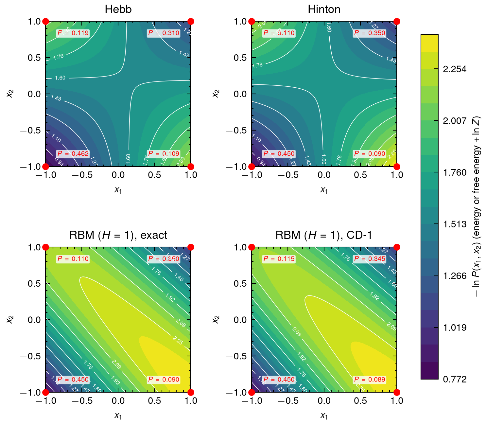

# Boltzmann Machine Tutorial

A minimal Rust walkthrough of the smallest Boltzmann machine: two spins, one coupling, two biases.
The code fits the model to data with the Hebb rule and compares the result with the data distribution.

## Model

Two spins $x_1, x_2 \in \{+1, -1\}$ with energy

$$
E(x_1, x_2) = -W x_1 x_2 - b_1 x_1 - b_2 x_2
$$

and Boltzmann distribution

$$
P(x) = \frac{e^{-E(x)}}{Z}, \qquad Z = \sum_{x} e^{-E(x)} .
$$

Low-energy states are more probable. $W > 0$ favours aligned spins, $b_i > 0$ favours $x_i = +1$.

## Hebb rule

Set each parameter to the data average of the term it multiplies:

$$
b_1 = \langle x_1 \rangle_{\text{data}}, \qquad
b_2 = \langle x_2 \rangle_{\text{data}}, \qquad
W = \langle x_1 x_2 \rangle_{\text{data}} .
$$

This is not maximum likelihood. Maximizing $\mathbb{E}_{\text{data}}[\ln P]$ gives

$$
\frac{\partial}{\partial W}\,\mathbb{E}_{\text{data}}[\ln P] = \langle x_1 x_2 \rangle_{\text{data}} - \langle x_1 x_2 \rangle_{\text{model}},
$$

so the exact fit matches model averages to data averages. Starting from $W = b_1 = b_2 = 0$, where all
model averages vanish, one gradient step of size 1 is exactly the Hebb rule.

## Example

Data: $P_0(++) = P_0(--) = 0.4$, $P_0(+-) = P_0(-+) = 0.1$, so $\langle x_1 x_2 \rangle_{\text{data}} = 0.6$.

| State | Data $P_0$ | Hebb model $P$ ($W = 0.6$) |
|---|---|---|
| $(+1, +1)$ | 0.400 | 0.384 |
| $(+1, -1)$ | 0.100 | 0.116 |
| $(-1, +1)$ | 0.100 | 0.116 |
| $(-1, -1)$ | 0.400 | 0.384 |

The Hebb model under-shoots the correlation ($\tanh 0.6 \approx 0.537 < 0.6$).
The exact solution is $\tanh W = 0.6$, i.e. $W = \tfrac12 \ln 4 \approx 0.693$, which reproduces $P_0$ exactly.



The energy extended to $[-1, 1]^2$. Only the four corners are spin states; the aligned corners are the
low-energy attractors.

## Run

```bash
cargo run                        # fit, print P vs P0, write data/energy_grid.parquet
python3 scripts/plot_contour.py  # contour_energy.png / .pdf
```

The Rust side uses [Peroxide](https://github.com/Axect/Peroxide) (`parquet` feature) for the grid and the
parquet output. The plot needs `pandas`, `pyarrow`, `matplotlib` and `scienceplots`.
